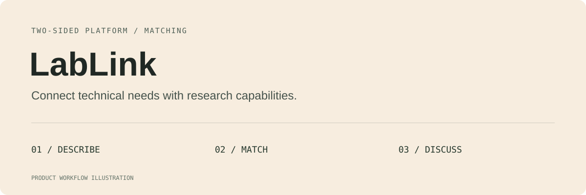
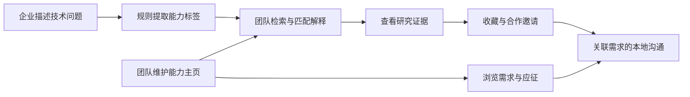
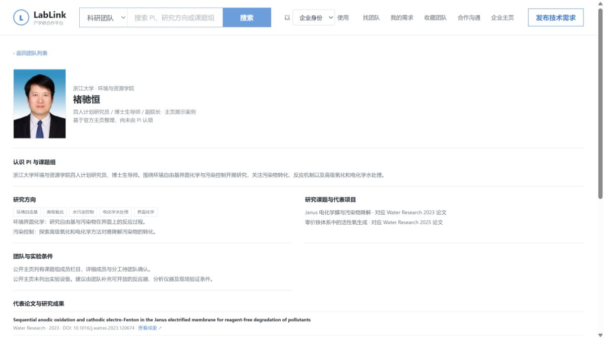

# LabLink

### 面向中小企业与高校团队的产学研需求撮合原型

**从一个技术问题，到可解释的团队匹配，再到合作讨论。**

[产品案例](docs/case-study.md) · [演示场景](#两个可以开始演示的场景) · [当前边界](#当前边界)

> 本仓库当前提供产品案例文档。下述功能对应本地 LabLink 原型；应用源码与可运行发布包尚未在本仓库提供。

## 它能帮企业和研究团队做什么

“产品反复开裂，我们想找高校合作，但不知道该搜哪个学科，也不知道怎么把问题讲清楚。”

LabLink 从企业的实际问题出发，把需求拆成技术能力，展示团队研究方向与匹配解释，再把需求、应征和沟通放在同一条路径里。高校团队则从自身研究能力出发，寻找适合讨论的企业问题。

| 使用者要做的事 | 本地原型提供的帮助 |
| --- | --- |
| 企业说清楚问题 | 填写背景、技术任务、企业资源、交付与验收条件 |
| 企业寻找团队 | 查看研究方向、能力标签、论文证据与匹配说明 |
| 团队寻找项目 | 以导师身份浏览需求、维护团队主页、记录应征 |
| 双方保留合作上下文 | 需求关联、合作邀请、会话与本地留言 |
| 回看已关注对象 | 收藏团队、查看我的需求与我的应征 |

## 五个让合作更容易开始的设计

### 01　把业务语言翻译为技术能力

企业通常描述“开裂、误判、磨损”，高校团队通常描述“断口分析、机器视觉、寿命预测”。当前原型通过关键词规则连接两种表达，并输出技能标签与复杂度初步判断。

> **试一试：** 产品反复开裂，希望做失效分析，查清材料和工艺因素。

当前规则包含“裂纹／断裂／开裂／失效 → 断口分析、材料表征”等映射。它的价值是让拆解过程可见、可讨论；**当前不调用大模型，不将规则匹配描述为 AI 推理。**

### 02　需求表围绕合作可行性组织

除了项目标题和领域，发布页还包含问题背景、技术任务、企业资源、合作方要求、交付与验收标准、预算、周期、地点、截止时间与可选图片。

这些信息帮助双方在正式接触前识别合作条件，减少只有宽泛关键词、却无法判断能否承接的情况。

### 03　匹配解释要能回到研究证据

团队页展示研究方向、公开论文和来源链接，用“研究证据 → 可能讨论的企业问题”解释相关性。公开导师档案与虚构流程演示团队分别标识。

本地原型保留了 5 个公开 PI 主页案例与 5 个虚构团队。公开档案尚未由本人认领，研究相关性不代表设备可用、团队承接意愿或已建立合作。

*本地原型实际界面，页面保留公开来源与“尚未认领”标识。仅演示研究信息的组织方式。*

### 04　企业和导师有各自的操作路径

企业侧重点是找团队、发布需求、收藏和联系；导师侧重点是找项目、查看应征和维护能力主页。导航、搜索范围与主要操作随演示身份调整。

当前身份切换保存在浏览器中，是体验入口；它不提供真实登录、多用户隔离或后端授权。

### 05　沟通保留需求上下文

聊天工作区采用会话列表与记录双栏，支持会话搜索、关联需求跳转、消息草稿和快捷文本。邀请、应征、留言保存在本机 SQLite，便于连续演示。

**保存消息不会向真实团队发送。** 当前没有跨用户投递、在线状态或已读回执。

## 两个可以开始演示的场景

### 场景 A：制造企业寻找失效分析能力

**输入任务：** 产品反复开裂，需要分析失效原因，并讨论材料或工艺改进方向。

**演示路径：** 发布需求 → 查看规则拆解 → 浏览相关团队 → 核查研究方向与论文 → 记录合作邀请。

**观察重点：** 标签能否反映问题、匹配解释能否被理解、需求信息是否足以开始沟通。此场景用于验证流程，不代表已撮合真实项目。

### 场景 B：从公开研究证据开始讨论

本地团队案例以浙江大学褚驰恒公开主页和论文为来源，展示水处理相关研究如何关联到企业提出的处理效果、工艺路线等问题。

来源入口：[浙江大学公开主页](https://person.zju.edu.cn/chihengchu)。公开研究信息仅用于产品展示，不代表本人授权入驻、合作承诺或平台已建立联系。更完整的案例说明见[产品案例](docs/case-study.md)。

## 技术如何支撑这些体验

| 模块 | 当前本地实现 |
| --- | --- |
| 前端 | HTML、JavaScript 与静态资源 |
| 服务端 | Node.js 24+，不依赖第三方 npm 包 |
| 需求拆解 | 关键词规则与行业兜底 |
| 记录保存 | SQLite 保存需求、收藏、应征、邀请和留言 |
| 图片 | 本机 uploads 保存文件，数据库保存元数据 |
| 演示身份 | 浏览器保存企业／导师切换状态 |

## 文档与体验状态

| 入口 | 内容 |
| --- | --- |
| [产品案例](docs/case-study.md) | 问题、决策、拆解示例与评估计划 |
| 当前 README | 双边流程、本地功能与公开展示边界 |

本仓库暂不提供克隆即运行的启动指令。公开应用版本需补充源码、脱敏演示数据和运行说明。

## 当前边界

匹配分数是原型规则，不代表合作成功率；公开论文相关性不代表团队具备产业交付能力。初始企业需求为演示材料，不是真实客户；公开档案与虚构档案均不意味着真实入驻。

下一步优先验证需求填写成本、候选相关性、匹配解释可理解性、合作信息缺口和双边使用意愿。语义匹配、真实身份认领、多用户通信与合作成效评估属于后续方向。尚无真实撮合率、用户规模或成交金额的实测结论。
