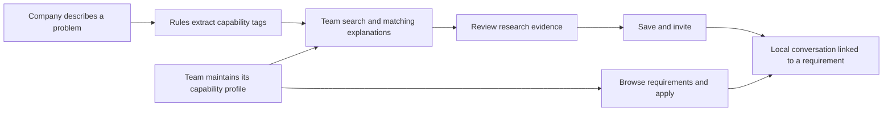

# LabLink

**English** · [中文](README.zh-CN.md)

### A university–industry matching prototype for SMEs and research teams

**From a technical problem to an explainable match—and a cooperation discussion.**

[Product case study (中文)](docs/case-study.md) · [Demo scenarios](#two-demo-scenarios) · [Current boundaries](#current-boundaries)

> This repository currently contains product case documentation. The features below refer to the local LabLink prototype; application source code and a runnable release are not yet provided here.

## What it helps companies and research teams do

“Our products keep cracking. We want to collaborate with a university, but we don't know which discipline to search for or how to describe the problem.”

LabLink starts with a company's practical problem, maps requirements to technical capabilities, and presents research directions with matching explanations. Requirements, applications, and communication form one journey. Research teams can approach from the other side, using their capabilities to discover relevant company problems.

| User task | What the local prototype offers |
| --- | --- |
| Companies describe their problem | Background, technical tasks, company resources, deliverables, and acceptance criteria |
| Companies find teams | Research directions, capability tags, paper references, and matching explanations |
| Teams discover projects | A researcher view for browsing requirements, maintaining a profile, and recording applications |
| Both sides retain context | Linked requirements, cooperation invitations, conversations, and local messages |
| Return to promising leads | Saved teams, company requirements, and team applications |

## Five decisions that make collaboration easier to start

### 01 Translate business language into technical capabilities

Companies describe cracking, misclassification, and wear. Research teams describe fracture analysis, machine vision, and lifetime prediction. The current prototype connects these expressions with keyword rules, producing skill tags and an initial complexity indication.

> **Try it:** Describe a product that keeps cracking and needs failure analysis to investigate material and process factors.

The rules include mappings such as “裂纹 / 断裂 / 开裂 / 失效” (cracks, fracture, cracking, failure) → fracture analysis and materials characterization. The goal is to make decomposition visible and discussable. **The current analyzer does not call an LLM; rule matching is not presented as AI reasoning.** Demo input should use the Chinese keywords recognized by the current rules.

### 02 Structure requirements around feasibility

Beyond a title and field, the publishing form includes background, technical tasks, company resources, partner requirements, deliverables and acceptance criteria, budget, timeline, location, deadline, and optional images.

These fields help both sides identify cooperation conditions before making contact, rather than relying on broad keywords that reveal little about whether a project can be taken on.

### 03 Connect matching explanations to research evidence

Team pages show research directions, public papers, and source links, connecting research evidence to company problems that might be worth discussing. Public faculty profiles are distinguished from fictional workflow-demo teams.

The local prototype contains five public principal-investigator profile examples and five fictional teams. Public profiles have not been claimed by their subjects. Research relevance does not establish available equipment, willingness to participate, or an existing partnership.

*Actual local prototype interface, retaining public-source and unclaimed-profile labels. It demonstrates how research information is organized.*

### 04 Give companies and researchers different journeys

Companies focus on finding teams, publishing requirements, saving candidates, and making contact. Researchers focus on finding projects, reviewing applications, and maintaining capability profiles. Navigation, search scope, and primary actions adapt to the demo role.

Role switching is stored in the browser. It is an experience preview, without real authentication, multi-user isolation, or backend authorization.

### 05 Keep communication connected to the requirement

A two-column workspace combines a conversation list and message history, with search, requirement links, drafts, and quick text. Invitations, applications, and messages are stored in local SQLite for a continuous demonstration.

**Saving a message does not send it to a real team.** Cross-user delivery, online presence, and read receipts are not implemented.

## Two demo scenarios

### Scenario A: A manufacturer seeks failure-analysis expertise

**Task:** Investigate repeated product cracking and discuss possible material or process improvements.

**Journey:** Publish a requirement → inspect rule-based decomposition → browse relevant teams → review research directions and papers → record an invitation.

**What to observe:** Whether tags reflect the problem, matching explanations make sense, and the requirement contains enough information to begin a conversation. This validates a prototype workflow, not a completed real-world match.

### Scenario B: Start a discussion from public research evidence

A local team-profile example uses Zhejiang University researcher Chiheng Chu's public profile and papers to illustrate how water-treatment research can relate to company questions about treatment performance and process options.

Source entry: [Zhejiang University public profile](https://person.zju.edu.cn/chihengchu). Public information is used for product demonstration; it does not imply authorized membership, a commitment to cooperate, or an established relationship. See the [product case study (中文)](docs/case-study.md) for further context.

## How the technology supports the experience

| Module | Current local implementation |
| --- | --- |
| Frontend | HTML, JavaScript, and static assets |
| Backend | Node.js 24+, without third-party npm dependencies |
| Requirement analysis | Keyword rules and industry fallbacks |
| Records | SQLite stores requirements, saved teams, applications, invitations, and messages |
| Images | Local uploads store files; the database stores metadata |
| Demo roles | Browser-persisted company/researcher role switching |

## Documentation and availability

| Entry | Contents |
| --- | --- |
| [Product case study (中文)](docs/case-study.md) | Problem, decisions, decomposition example, and evaluation plans |
| This README | Two-sided workflows, local features, and public documentation scope |

There are no clone-and-run instructions for this repository yet. A public application release should include source code, sanitized demo data, and setup instructions.

## Current boundaries

Match scores come from prototype rules, not measured probabilities of cooperation. Relevant publications do not establish a team's ability to deliver an industrial project. Initial company requirements are demo materials rather than real clients. Neither public profiles nor fictional profiles imply actual platform membership.

Next priorities are requirement-entry effort, candidate relevance, explanation clarity, missing cooperation information, and willingness on both sides to use the platform. Semantic matching, verified identities, multi-user messaging, and outcome evaluation remain future directions. No real matching conversion rate, user scale, or transaction value is reported.
